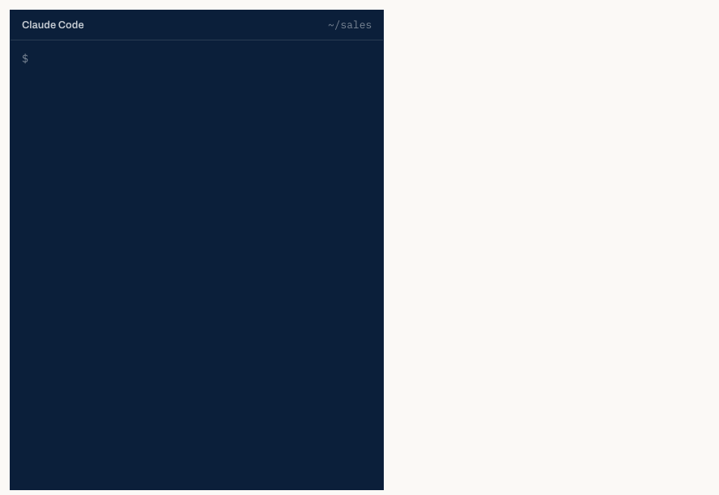

# dealdesk.studio

The marketing site for **Deal Desk Studio**, built with Docusaurus and deployed to GitHub Pages at
[dealdesk.studio](https://dealdesk.studio).

The product itself lives in [`dealdeskco/dealdesk`](https://github.com/dealdeskco/dealdesk) and is
served from `app.dealdesk.studio`. This repository holds only the public site: landing page,
pricing, Help, the developer docs, blog and legal pages, in English, Latin American Spanish (`es`,
under `/es`) and Spain's Spanish (`es-ES`, under `/es-ES`).



## Running it

```bash
npm ci
npm start          # dev server on :3000
npm run build      # production build into ./build
npm run serve      # serve the built output
```

`onBrokenLinks` is set to `throw`, so a dead internal link fails the build rather than shipping.

## Conventions worth knowing

- **Brand constants live in `src/css/custom.css`** and are copied verbatim from the application's
  palette, so the site and the product do not drift apart. Change them in both places or neither.
- **`src/pages/index.module.css` is shared** by the landing page and `how-it-works`, so the two
  cannot diverge visually.
- **Pricing is duplicated** from `plans.mjs` in the application repo, which is the billing source
  of truth. Nothing enforces agreement between them — if a price changes there, change it here.
- **The developer docs (`developers/`, served at `/docs/developers`) are checked against the API.**
  `data/developer-contract.json` is a copy of the app's generated contract, and
  `scripts/check-developer-contract.mjs` runs before every build: an endpoint or MCP tool missing
  from the docs in any locale fails the build. See `data/README.md`.
- **Which AI clients work today is one field each**, in `src/data/agentClients.tsx`. The clients
  that connect by signing in with Deal Desk (OAuth) all follow `OAUTH` there: change it to
  `'available'` when OAuth ships and the home page, `/agents`, `/developers` and the docs follow.
- **Three locales.** Every page, doc and theme string has an `es` and an `es-ES` translation under
  `i18n/`. Add a string in both, or the Spanish pages show it in English.
- **Recordings and screenshots** of the product are in `static/img/agents/`, one per locale where
  they carry text (`-es`, `-es-ES`).
- **The contact form has no backend here.** It posts to `app.dealdesk.studio/api/contact`, which
  already owns the mail provider chain (SES, falling back to Resend), the branded templates and
  the rate limiting.

## Deployment

Pushing to `main` builds and publishes via `.github/workflows/deploy.yml`. `static/CNAME` pins the
custom domain; GitHub Pages needs the matching DNS records on the apex.
